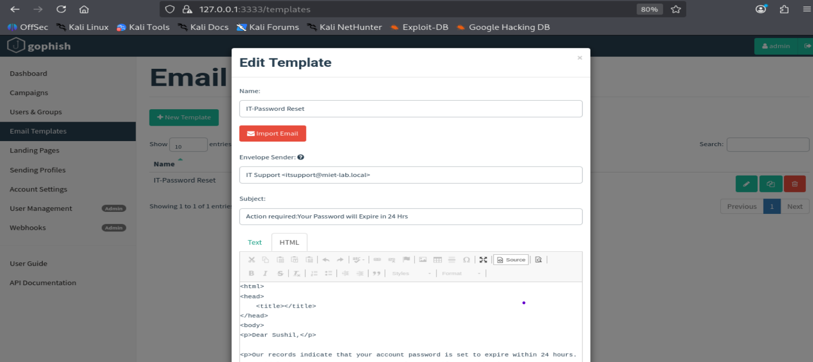
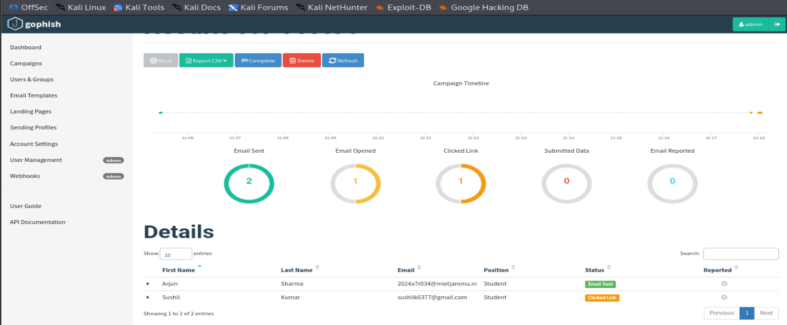

# Experiment 10: Hydra Password Guessing

## Aim

To perform a controlled password-guessing demonstration using Hydra in an authorized lab environment and to document the observed results through screenshots.

## Scope and Safety

This experiment is for an authorized lab setup only. Hydra must only be used against systems that the tester owns or has explicit permission to assess. Do not publish real passwords, recovered credentials, or sensitive target information in screenshots.

## Requirements

- Kali Linux / Linux-based penetration testing system
- Hydra installed
- A target host or service in a lab environment
- Wordlist or username/password list
- A terminal for command execution

## Procedure

### Step 1: Launch Hydra against the lab target

The screenshots document the controlled lab exercise, from initial setup through the observed results. Keep target details and any credentials redacted when sharing screenshots.

## Screenshots

## Result

The lab demonstrated password-guessing testing against an authorized lab service. The screenshots document the exercise flow and observed outcome.

## Conclusion

This experiment helped illustrate the risks of password guessing and the importance of strong, unique passwords, rate limiting, multi-factor authentication, and monitoring for repeated failed logins.
