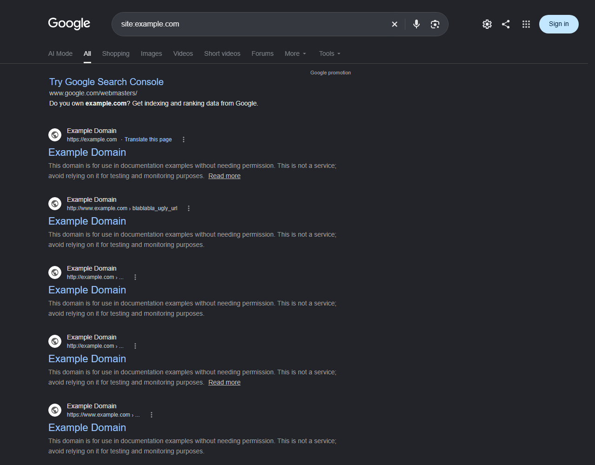
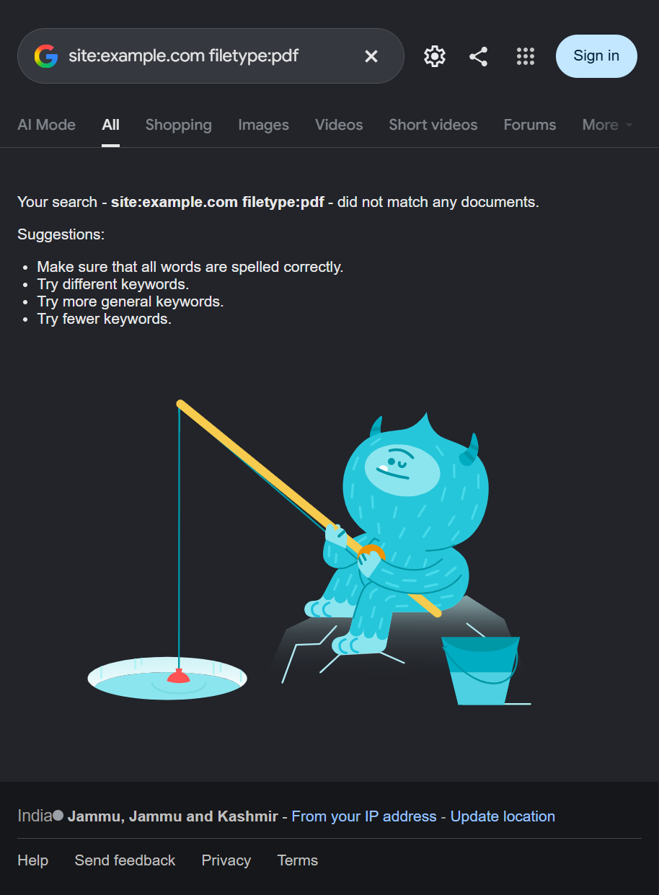
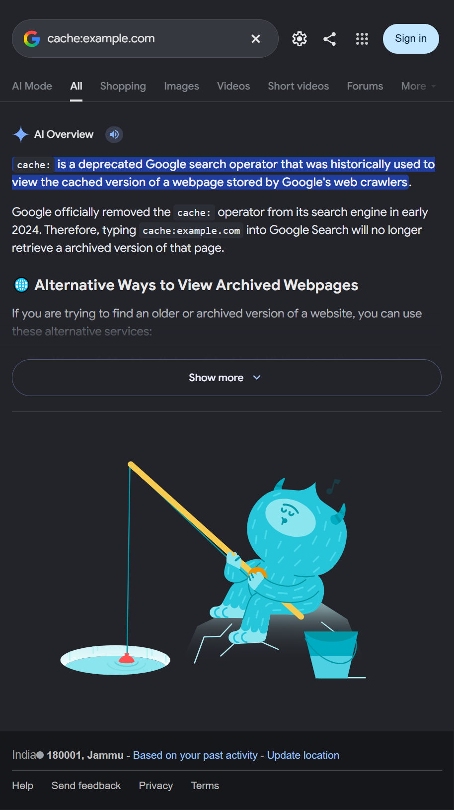
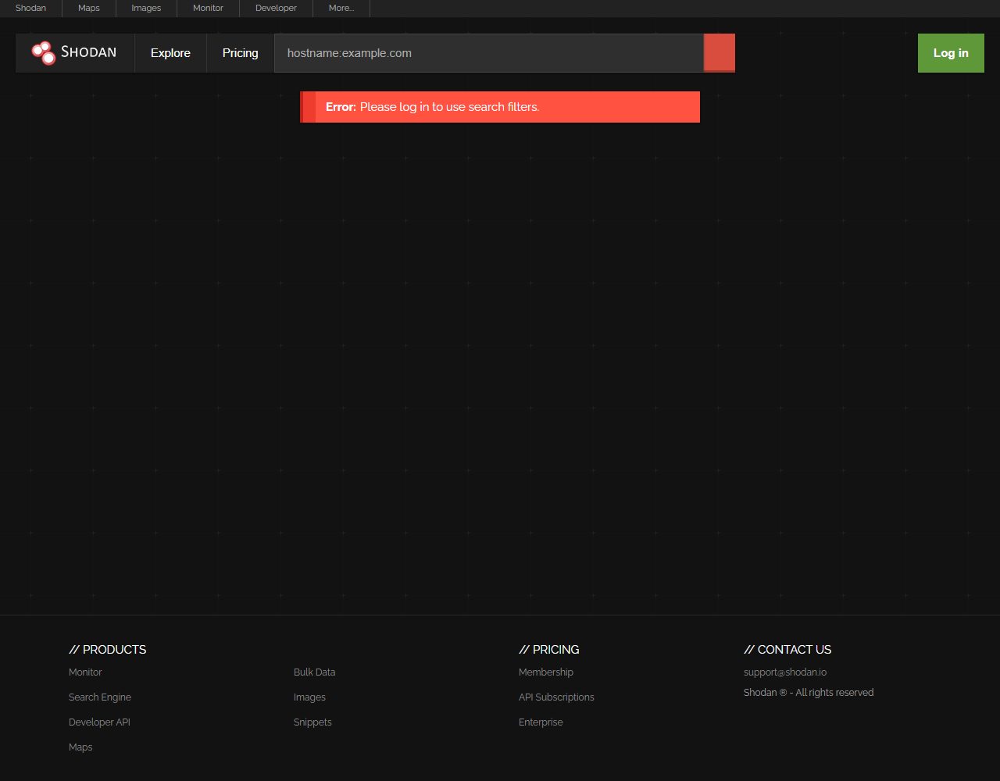
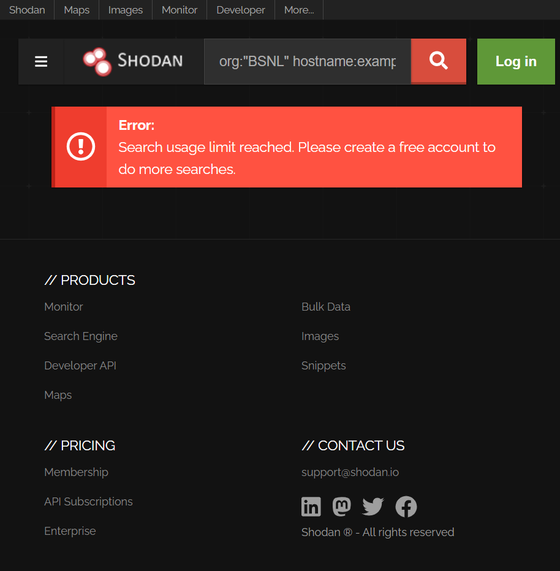

# Experiment 7: Using OSINT Tools for Reconnaissance

## Aim

To use Google search operators and Shodan for passive reconnaissance and understand the public information these tools may reveal.

## Requirements and scope

- Browser and internet connection
- Google Search and Shodan

All searches in this experiment were restricted to `example.com`, a reserved domain for documentation examples. No real organization or public service was targeted, and no active scans or service exploitation were performed.

## Theory

### Google search operators

Google operators help narrow pages already in its index. The `site:` operator limits results to a domain, while `filetype:` searches for a kind of file. In this authorized example, `site:example.com` was used to keep the search within the reserved domain.





Operators such as `intitle:` and `inurl:` can narrow results by page title or URL. Only snippets were reviewed; no login pages or sensitive material were opened. The `cache:` operator is deprecated and may not return current results.



### Shodan

Shodan indexes information about internet-connected hosts and services, including ports and service banners. Searches in this experiment included `hostname:example.com` to stay within the reserved domain.





## Procedure

### Step 1: Search with Google

Run operator examples using the reserved domain, for example:

```text
site:example.com
site:example.com filetype:pdf
site:example.com intitle:"index of"
site:example.com inurl:login
```

Review snippets only and do not try to access private or sensitive material. Results can change as Google's index is updated.

### Step 2: Search with Shodan

Add `hostname:example.com` to each query to keep searches within the reserved scope. Query types included hostname, service, organization, port, and product searches.

## Result

Google returned pages for the reserved domain and no matches for the example PDF query. Shodan's access limits prevented viewing filtered results; no IP addresses, open ports, or service banners were observed from the authorized example-domain searches.

## Conclusion

This experiment demonstrated how Google and Shodan can support passive reconnaissance within a safe scope. Search results alone do not confirm an exposure or vulnerability. The presentation's Nmap/Nessus-based exercise followed a more active scanning workflow, but this lab was deliberately limited to passive, non-invasive discovery.
